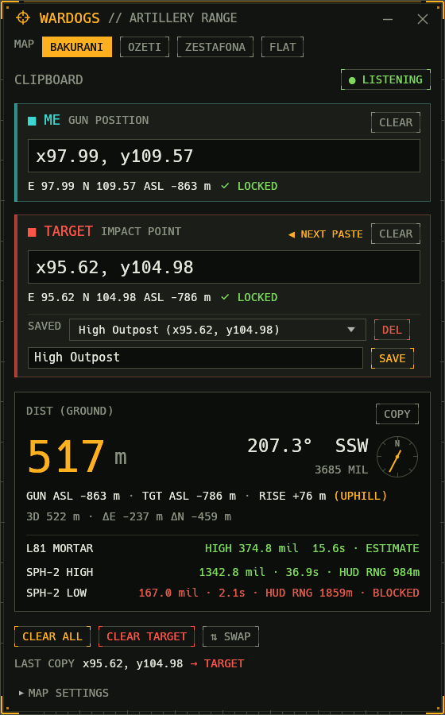
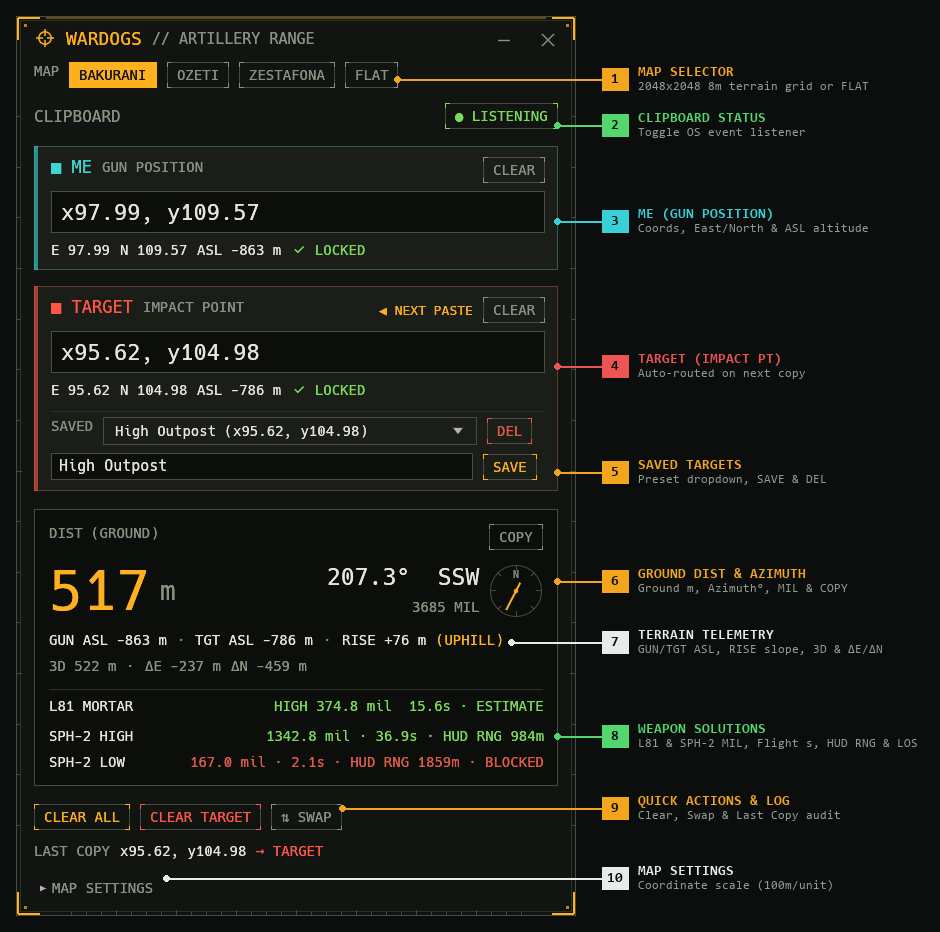

# WARDOGS // Artillery Range Calculator

A lightweight, standalone desktop range, bearing, and ballistic sight calculator for **WARDOGS** artillery and mortar crews, built in Rust with [`egui`](https://github.com/emilk/egui) / [`eframe`](https://github.com/emilk/egui/tree/master/crates/eframe).

It monitors your system clipboard for in-game coordinates (such as `x95.62, y104.98`), populating your gun position (**ME**) and impact point (**TARGET**), and automatically computes the exact elevation-corrected sight range, bearing, and weapon mil solutions using embedded offline terrain models.

<p align="center">
  
</p>

---

## Interface & Field Reference

<p align="center">
  
</p>

### 1. Map Selector (`MAP`)
Selects the active terrain elevation model used to sample altitudes and compute elevation-compensated ballistic trajectories:
- **`BAKURANI` / `OZETI` / `ZESTAFONA`**: Uses the embedded lossless $2048 \times 2048$ (8 m per cell) offline terrain heightfield ($16.384 \times 16.384\text{ km}$, $X, Y \in [0.0, 163.84]$) with half-pixel cell-center bilinear interpolation to look up exact ground elevation in metres above sea level (`ASL`) at both coordinates and along the firing line.
- **`FLAT`**: Disables terrain elevation (`RISE = 0 m`), computing pure 2D horizontal distance and level-ground firing solutions.

### 2. Clipboard Status (`CLIPBOARD`)
Controls the OS event-driven background clipboard listener ([`clipboard-rs`](https://crates.io/crates/clipboard-rs)):
- **`● LISTENING`** *(Green)*: Listens for OS clipboard change events (zero polling) and immediately captures valid in-game coordinates (e.g. `x97.99, y109.57`) while ignoring unrelated text. Click to pause.
- **`○ PAUSED`** *(Muted)*: Clipboard event handling is suspended; coordinates can still be entered or edited manually.

### 3. Gun Position Card (`■ ME — GUN POSITION`)
Represents your artillery piece or mortar position (cyan accent):
- **Coordinate Input Field (`x97.99, y109.57`)**: Displays your current position. When empty, the very first coordinate copied to the clipboard is routed here automatically. You can also type or paste coordinates manually.
- **`CLEAR` Button**: Empties the **ME** field so the next copied coordinate will populate your gun position again.
- **`◀ NEXT PASTE` Badge** *(shown when `ME` is empty)*: Indicates that the next coordinate copied in-game will land in this card.
- **Telemetry & Validation Bar (`E 97.99 N 109.57 ASL -863 m ✔ LOCKED`)**:
  - **`E` / `N`**: Parsed Easting ($X$) and Northing ($Y$) map coordinates.
  - **`ASL {z} m`**: Interpolated terrain altitude in metres above sea level (hidden in `FLAT` mode or if out of bounds).
  - **Status Indicator**: `✔ LOCKED` when valid coordinates are parsed, `AWAITING COORDINATES` when blank, or `✖ UNREADABLE — USE x95.62, y104.98` if the text cannot be parsed.

### 4. Target Position Card (`■ TARGET — IMPACT POINT`)
Represents the enemy impact point (red accent):
- **`◀ NEXT PASTE` Badge**: Once **ME** is populated, this badge appears on **TARGET** to show that all subsequent clipboard copies automatically update the target without disturbing your gun position.
- **Coordinate Input Field (`x95.62, y104.98`)**: The target's map coordinates, updated via clipboard or manual typing.
- **`CLEAR` Button**: Clears only the target coordinates and active target name.
- **Telemetry & Validation Bar (`E 95.62 N 104.98 ASL -786 m ✔ LOCKED`)**: Shows the target's parsed Easting (`E`), Northing (`N`), terrain elevation (`ASL`), and coordinate lock state.

### 5. Saved Targets (`SAVED`)
Built into the bottom of the **TARGET** card for storing and recalling frequent fire missions (persisted across restarts):
- **`SAVED` Dropdown (`High Outpost (x95.62, y104.98)`)**: Select any previously stored target to immediately load its coordinates into **TARGET**.
- **`DEL` Button**: Appears whenever the active target coordinates match a saved entry; click to delete that preset.
- **Target Name Input (`High Outpost`)**: Enter a custom callsign or landmark name for the current target coordinates.
- **`SAVE` Button**: Saves the current target coordinates under the entered name (or overwrites an existing preset with the same name). Pressing `Enter` in the name box also saves.

### 6. Ground Distance & Azimuth Readout (`DIST (GROUND)` / `RANGE`)
The main firing solution header at the top of the solution panel:
- **`DIST (GROUND)` (`517 m`)**: Horizontal 2D ground distance in metres between **ME** and **TARGET** (header displays **`RANGE`** when `FLAT` map mode is selected).
- **`COPY` Button**: Copies a formatted one-line firing solution to your clipboard for pasting into squad chat:
  - With terrain elevation: `Dist: 517 m (Gun ASL: -863 m, Tgt ASL: -786 m, Rise: +76 m), 207.3° (3685 mil) | L81: 374.8 mil (15.6s) | SPH-2 High: 1342.8 mil (36.9s, HUD RNG 984m)`
  - Flat mode: `517 m, 207.3° (3685 mil)`
- **Compass Bearing (`207.3° SSW`)**: Clockwise azimuth from true north (`000.0°–360.0°`) alongside the 16-point cardinal compass direction (`N`, `NNE`, `NE`, …, `SSW`, etc.).
- **Azimuth in Mils (`3685 MIL`)**: Bearing converted to the standard NATO `6400` mil circle.
- **Compass Rose**: Visual azimuth indicator with a North (`N`) marker and amber needle pointing along the firing bearing.

### 7. Spatial & Terrain Telemetry
Detailed geometric breakdown below the main distance readout:
- **`GUN ASL -863 m · TGT ASL -786 m · RISE +76 m (UPHILL)`**: Gun and target elevations in metres above sea level alongside the vertical height difference (`RISE`), paired with a slope badge:
  - **`(UPHILL)`** *(Amber)*: Target is $> 0.5\text{ m}$ above your gun.
  - **`(DOWNHILL)`** *(Green)*: Target is $> 0.5\text{ m}$ below your gun.
  - **`(LEVEL)`** *(Muted)*: Height difference is within $\pm 0.5\text{ m}$.
  - **`(FLAT / NO TERRAIN)`**: Shown when `FLAT` mode is active or coordinates lie outside the terrain grid.
- **`3D 522 m · ΔE -237 m ΔN -459 m`**: Direct line-of-sight 3D slant distance ($\sqrt{\text{GROUND}^2 + \text{RISE}^2}$) and signed East/West ($\Delta E$) and North/South ($\Delta N$) distance components in metres.

### 8. Weapon Ballistic Solutions (`L81 MORTAR`, `SPH-2 HIGH`, & `SPH-2 LOW`)
Weapon-specific firing solutions accounting for horizontal distance, altitude difference (`RISE`), and intermediate terrain line-of-fire clearance:
- **`L81 MORTAR`** *(81mm Mortar — Max range `684 m`, `45°–88°` high arc)*:
  - When in range: Displays `HIGH <mil> mil  <Flight Time>s · ESTIMATE` (or `· BLOCKED` in red if an intermediate hill/ridge intercepts the shell trajectory).
  - When out of envelope: Displays `TOO CLOSE · MIN 30 m`, `OUT OF RANGE · MAX 684 m`, or `NO SOLUTION`.
- **`SPH-2 HIGH`** *(155mm Howitzer High Arc — `45°–85°`)* and **`SPH-2 LOW`** *(155mm Howitzer Low Arc — `0°–45°`, Max range `2827 m`)*:
  - Simulates the 21-point Mach aerodynamic drag curve (`300 m/s` muzzle velocity, `dt = 0.02s`) and projects the in-game sight's **`HUD RNG`** readout relative to the map's HUD reference plane (`-863 m` on Bakurani).
  - Traces the full 3D trajectory against the $2048 \times 2048$ terrain heightfield (from `2 m` muzzle height) to detect terrain collisions (`BLOCKED`).
  - Example:
    - `SPH-2 HIGH`: `1342.8 mil · 36.9s · HUD RNG 984m` *(Green — clear trajectory)*
    - `SPH-2 LOW`: `167.0 mil · 2.1s · HUD RNG 1859m · BLOCKED` *(Red — obstructed by terrain)*

### 9. Quick Actions & Clipboard Audit Log
- **`CLEAR ALL`**: Clears both **ME** and **TARGET** cards and resets the clipboard routing state.
- **`CLEAR TARGET`**: Clears only **TARGET** while keeping **ME** locked so you can immediately copy a new target.
- **`⇅ SWAP`**: Swaps the **ME** and **TARGET** coordinates (useful for reverse-azimuth or counter-battery checks).
- **`LAST COPY` Status Line (`LAST COPY x95.62, y104.98 → TARGET`)**: Confirms the last coordinate read from the clipboard and which card (`→ ME` or `→ TARGET`) received it.

### 10. Map Settings (`▸ MAP SETTINGS`)
A collapsible footer for custom map calibration:
- **`SCALE` (`100 m / unit`)**: Drag or type to adjust how many metres equal `1.0` coordinate unit (in *WARDOGS*, `1` unit = `100 m`, so `0.01` = `1 m`).
- **`RESET` Button**: Restores the coordinate scale to the standard `100 m / unit`.

---

## Features

- **Exact `wardogs.zone` Ballistics & Terrain Parity**:
  - **SPH-2 (155mm HE)**: Solves both **High Arc** (`SPH-2 HIGH`) and **Low Arc** (`SPH-2 LOW`) trajectories using the 21-point velocity drag curve (`v0 = 300 m/s`, `0.0625 deg/mil`), displaying elevation in mils (`0.1 mil` precision), flight time in seconds, and projected in-game **`HUD RNG`** in metres.
  - **L81 Mortar (81mm)**: Solves high-angle mortar trajectories (`v0 = 84 m/s`, `0.05625 deg/mil`), displaying mil elevation and time of flight (`ESTIMATE`).
  - **3D Terrain Collision Detection (`BLOCKED`)**: Samples the terrain heightfield every `8 m` along the firing line (with binary search refinement) from a `2 m` muzzle height to warn when a ridge or hill blocks the shell's path.
- **Map Selection & Lossless Offline Elevation Grids**:
  - Segmented map selector supporting **BAKURANI**, **OZETI**, **ZESTAFONA**, and **FLAT** (flat-earth / 2D-only mode).
  - Lossless $2048 \times 2048$ (8 m resolution, `0.25 m` vertical step) compressed elevation rasters embedded directly into the binary via `include_bytes!`. Completely offline, zero runtime I/O, no network calls, and single-file portable distribution.
  - Half-pixel cell-center $O(1)$ bilinear interpolation across the full $16.384 \times 16.384\text{ km}$ map space ($X, Y \in [0.0, 163.84]$).
  - Live altitude readout (`ASL {z} m`) on both **ME** and **TARGET** cards when a terrain map is active.
- **Spatial Firing Context**:
  - **Horizontal Ground Distance** (`DIST (GROUND)`) in metres.
  - **Gun ASL, Target ASL, and Rise** (`GUN ASL`, `TGT ASL`, `RISE`) with tactical slope indicators: `(UPHILL)`, `(DOWNHILL)`, or `(LEVEL)`.
  - **3D Slant Range** ($\sqrt{\text{Ground}^2 + \text{Rise}^2}$) and **East / North Offsets** (`ΔE` / `ΔN`) in metres.
  - **Compass Bearing** in degrees (`000.0°–360.0°`), 16-point cardinal direction, and **NATO mils** (`6400` mil circle) with an interactive compass rose.
- **Automatic Clipboard Listener**:
  - Watches the system clipboard via native OS change events ([`clipboard-rs`](https://crates.io/crates/clipboard-rs)) with zero background polling, ignoring unrelated copied text.
  - Automatically fills **ME** when empty, then routes all subsequent coordinate copies to **TARGET**.
  - Toggle listening on/off at any time with the `● LISTENING` / `○ PAUSED` button.
- **Target Management**:
  - Save, name, and recall targets via a quick-access dropdown on the target card.
  - Delete or overwrite targets with a single click.
- **Quick Controls & UI**:
  - Individual `CLEAR` buttons on both **ME** and **TARGET** cards, plus `CLEAR ALL`, `CLEAR TARGET`, and `⇅ SWAP`.
  - One-click `COPY` button formats a complete tactical firing report to clipboard.
  - Persistent window position, active map, coordinates, and saved targets across restarts.

---

## Coordinate Format

The calculator accepts coordinates copied from the game or typed manually:

| Mode | Supported Examples |
| :--- | :--- |
| **Clipboard & Manual Input** | `x95.62, y104.98`, `X: 95.62 Y: 104.98`, `y104.98 x95.62` |
| **Manual Input Only (Lenient)** | `95.62, 104.98`, `95.62 104.98` |

---

## Getting Started

### Prerequisites

- [Rust](https://rustup.rs/) `1.85` or newer (Rust 2024 edition compatible)

### Build & Run

```powershell
# Run in development mode
cargo run

# Build optimized release binary
cargo build --release
```

The compiled release executable will be located at:

```text
target/release/wardogs-range-calc.exe
```

### Run Tests

```powershell
cargo test
```

---

## Tooling & Offline Data Generation

To rebuild or update the pre-baked $2048 \times 2048$ compressed elevation binary grids (`WDE2` format: 2D delta predictor + byte-plane transpose + zlib level 9), an offline Python generator script is included:

```powershell
python scripts/generate_elevation_grids.py
```

Outputs compressed `u16` heightfield rasters directly into `src/assets/terrain/`.
